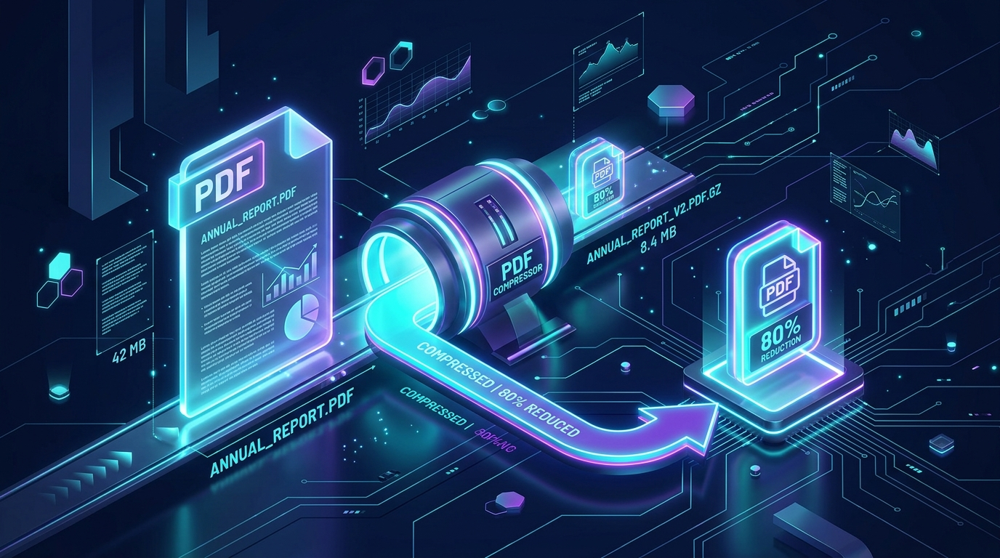

When applying for jobs, submitting documents to government portals, or simply trying to email a large presentation, you've likely encountered the dreaded **"File Size Too Large"** error. 

PDFs are notorious for ballooning in size, especially when they contain high-resolution images or scanned documents. Fortunately, reducing your PDF file size doesn't mean you have to settle for blurry images and unreadable text.

In this guide, we'll show you exactly how to compress PDFs without losing quality, and why doing it locally in your browser is the safest method.

## Why Do PDFs Get So Large?

Before we compress a PDF, it helps to understand what makes it so large in the first place:
1. **High-Resolution Images:** If a PDF contains photos straight from a smartphone or DSLR camera, each image could be 5MB+.
2. **Embedded Fonts:** Some PDFs embed entire font families rather than just the characters used, inflating the size.
3. **Hidden Data:** Programs like Adobe Illustrator or Word often save invisible metadata and editing capabilities inside the exported PDF.

## The Secret to Lossless Compression

"Lossless" compression means reducing the file size without any visible degradation in quality. Our tools achieve this by:
* Discarding invisible background metadata.
* Downscaling images to web-optimized resolutions (e.g., 144 DPI instead of 300 DPI) which look identical on computer screens.
* Optimizing font subsets.

## How to Compress Your PDF Instantly

You don't need to download expensive software like Adobe Acrobat to fix your file size. You can use our completely free [PDF Compressor](/tools/pdf-compressor).

1. **Upload your PDF:** Head over to the [PDF Compressor](/tools/pdf-compressor) tool and drag and drop your file.
2. **Select Compression Level:** If you need a massive reduction for an email attachment, choose "High Compression". If you just need a slight trim, choose "Standard Compression".
3. **Download:** The tool processes the file instantly directly on your device.

### Why Browser-Based Compression is Better

Unlike PDF compressors that rely on remote processing, **100ToolCrate processes selected PDF content inside your browser**.

Selected PDF content is handled in your browser, so the compressor does not upload your document content to our server.

[Try the PDF Compressor for free today &rarr;](/tools/pdf-compressor)
