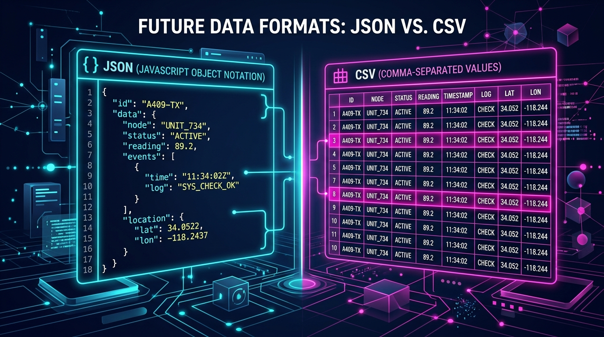

If you work with data, APIs, or web development, you are almost certainly dealing with **JSON** (JavaScript Object Notation) and **CSV** (Comma-Separated Values).

Both formats are used to store and transfer data, but they serve entirely different purposes. Choosing the wrong format can lead to bloated file sizes, unreadable data, or broken applications.

## What is CSV?

CSV is a simple, flat-file format where data is separated by commas. It looks exactly like a spreadsheet.

**Pros:**
* Extremely lightweight.
* Universally understood by business tools (Excel, Google Sheets).
* Easy for non-technical users to read and edit.

**Cons:**
* Cannot handle nested data (like lists within lists).
* No native support for data types (everything is a string).

## What is JSON?

JSON is a hierarchical format built on key-value pairs, designed specifically for the web.

**Pros:**
* Can handle complex, deeply nested data structures.
* Supports data types natively (booleans, numbers, arrays, strings).
* The absolute standard for REST APIs.

**Cons:**
* More verbose and larger file size than CSV.
* Harder for non-technical users to read.

## When Should You Convert?

You'll often find yourself needing to convert between the two. 
* **JSON to CSV:** When you pull data from a modern API but need to hand it off to an accountant or marketing team who uses Excel.
* **CSV to JSON:** When you have a massive spreadsheet database that you need to integrate into a modern JavaScript web application.

### The Easy Way to Convert

Instead of writing Python scripts to parse the data manually, you can use our instant [JSON to CSV Converter](/tools/json-to-csv). 

Simply paste your JSON array, and the tool will automatically flatten the nested data and generate a clean, downloadable CSV file. We also provide a full suite of [JSON Formatters and Validators](/tools/json-formatter) to ensure your data is always pristine!
