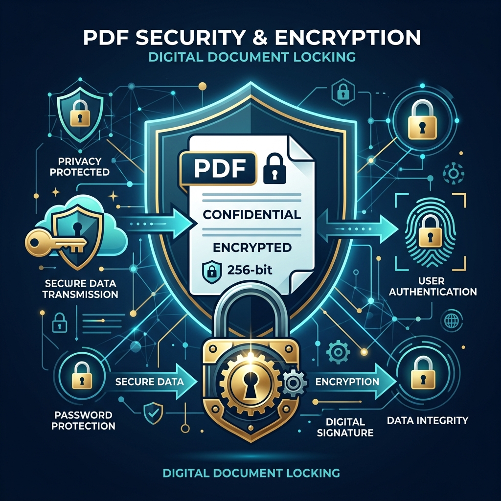

Whether you are combining bank statements for a mortgage application, merging tax documents, or assembling a confidential corporate contract, **PDF files often contain the most sensitive financial and personal data you own.**

Yet, millions of users upload these private documents to random online converters every single day without realizing what happens behind the scenes.

In this guide, we'll explain the hidden privacy risks of traditional PDF websites, how modern client-side processing works, and how to safely merge PDFs without compromising your data security.

---

## The Hidden Risk of Traditional PDF Converter Sites

When you use a standard online PDF merger, your document follows this pathway:

1. Your browser uploads your full PDF file over the internet to a third-party server.
2. The remote server processes, splits, or combines the pages.
3. The server sends back the output file for you to download.

**Why is this dangerous?**
Unless the website explicitly guarantees client-side execution, your files are stored—even if temporarily—on remote hardware controlled by unknown entities. If that backend server experiences a breach, has misconfigured cloud buckets, or logs user uploads, your sensitive financial records, contracts, or IDs could end up exposed.

---

## The Client-Side Revolution: WebAssembly & Privacy-First Tools

Fortunately, modern web browsers are practically lightweight operating systems. Thanks to technologies like **WebAssembly (Wasm)** and modern JavaScript libraries, PDF manipulation can happen entirely inside your browser's local memory.

### How Client-Side Merging Works:
* **Zero Uploads:** When you drop your PDFs into the tool, they never leave your device.
* **Instant Speed:** Because there is no network upload or server waiting time, processing is nearly instantaneous regardless of your file size.
* **Offline Capable:** Once the page loads, you could disconnect your Wi-Fi and the tool would still function perfectly!

---

## 4 Best Practices for Safe PDF Management

When working with confidential documents online, follow these rules:

1. **Verify Client-Side Processing:** Use tools like our free [PDF Merger](/tools/pdf-merger) that process your files strictly in browser memory.
2. **Remove Unnecessary Metadata:** PDFs store hidden metadata (author names, software versions, edit histories, creation dates). Strip this data using a [PDF Metadata Remover](/tools/pdf-metadata-remover) before sharing files publicly.
3. **Password Protect Sensitive Files:** Before emailing contract drafts or tax documents, add password encryption with a [PDF Lock](/tools/pdf-lock) tool.
4. **Inspect URL Schemes:** Ensure the website uses secure `https://` encryption and has clear, transparent privacy policies explaining data retention practices.

---

## Conclusion

You shouldn't have to trade your personal privacy just to combine two document pages. By choosing browser-native tools that respect user data, you can keep your confidential information exactly where it belongs: strictly on your own device.

Try our 100% private, browser-based [PDF Merger](/tools/pdf-merger) today!
