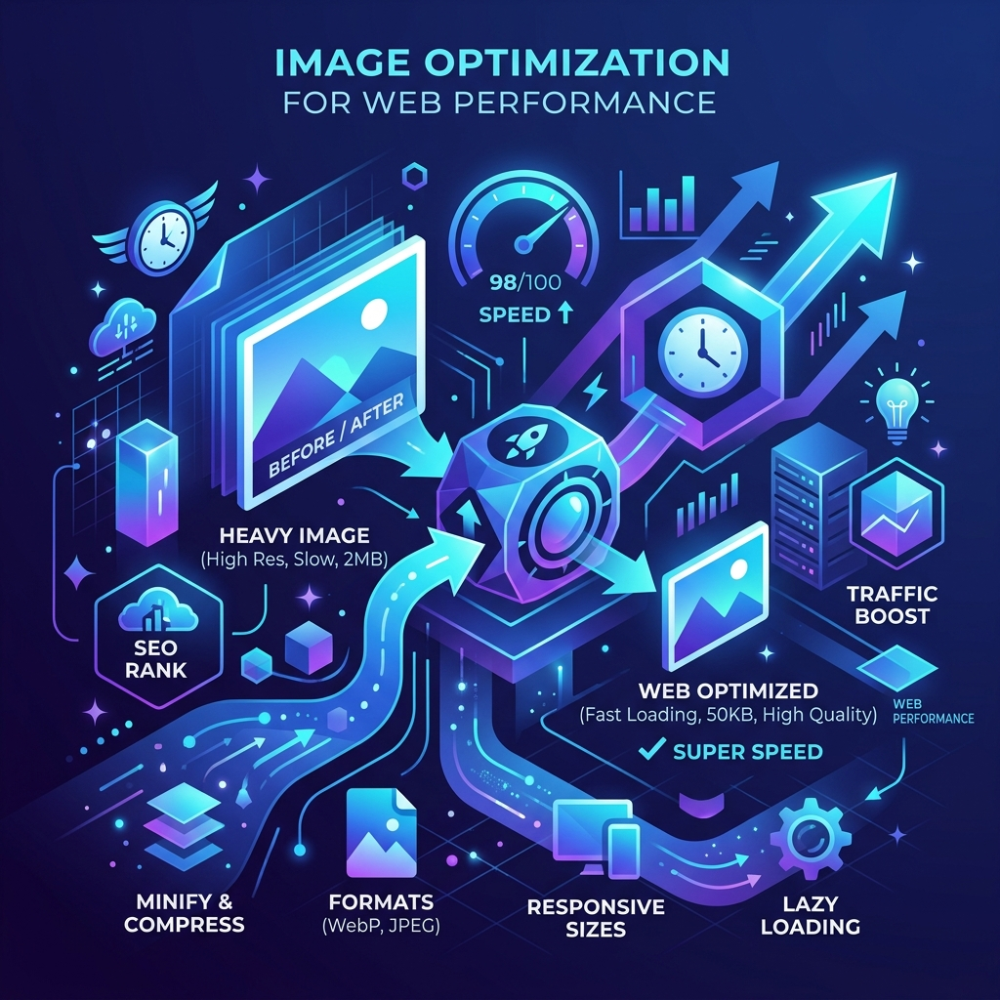

When it comes to web performance and SEO, there is one universal truth: **bloated images are the silent killers of your website's speed.** 

If you've ever run a Google PageSpeed Insights test and seen the dreaded "Serve images in next-gen formats" or "Properly size images" warnings, you aren't alone. Images account for over 60% of the average webpage's downloaded bytes. 

In this guide, we'll walk through exactly how to optimize your images for 2026's web standards so you can pass Core Web Vitals, increase user retention, and climb the Google search rankings.

---

## 1. Ditch JPG and PNG for Modern Formats (WebP & AVIF)

For decades, JPEG and PNG were the undisputed kings of the web. Today, they are legacy formats. If you want maximum performance, you need to be using **WebP** or **AVIF**.

* **WebP:** Developed by Google, WebP provides superior lossless and lossy compression. WebP lossless images are 26% smaller in size compared to PNGs, and lossy images are 25-34% smaller than comparable JPEG images.
* **AVIF:** The new gold standard. AVIF offers even better compression than WebP (often 50% smaller than JPEGs) while retaining incredible detail.

**Pro Tip:** You don't need expensive software to convert your images. You can use our free [WebP to JPG converter](/tools/webp-to-jpg) or [PNG to JPG converter](/tools/png-to-jpg) to manage your legacy assets, and our upcoming AVIF tools to modernize your site.

## 2. Compress Before You Upload

Never upload a raw image from your phone or camera directly to your website. A 5MB photograph might look beautiful, but it will decimate your Largest Contentful Paint (LCP) score.

Before uploading any image to your CMS, run it through an image compressor. You want to aim for a file size of **under 100KB** for standard images and **under 300KB** for large hero banners.

*If you need to compress images quickly, use our free [Image Compressor](/tools/image-compressor) tool directly in your browser.*

## 3. Responsive Images: The `srcset` Attribute

One of the biggest mistakes developers make is serving a massive 1920px wide desktop image to a mobile user whose screen is only 390px wide. This wastes bandwidth and battery life.

To fix this, use the HTML `<picture>` element or the `srcset` attribute to let the browser choose the appropriate image size based on the device's screen width.

```html

```

## 4. Lazy Loading is Non-Negotiable

If you have a blog post with 10 images, the browser shouldn't load the images at the bottom of the page until the user actually scrolls down to see them. This technique is called **lazy loading**, and it is crucial for initial page load speed.

Luckily, modern browsers natively support lazy loading. All you need to do is add `loading="lazy"` to your image tags:

```html

```

*Note: Never lazy-load your hero image (the first image visible "above the fold"), as this will actually hurt your LCP score!*

## 5. Explicit Width and Height (Preventing CLS)

Have you ever been reading an article on your phone, and suddenly the text jumps down because an image finally loaded? That is called Cumulative Layout Shift (CLS), and Google actively penalizes sites that do this.

To prevent CLS, always provide explicit `width` and `height` attributes to your images. This allows the browser to reserve the exact amount of space needed for the image before it even downloads.

```html

```

## Conclusion

Optimizing images doesn't have to be a tedious chore. By adopting next-gen formats like WebP, explicitly defining your dimensions, enabling lazy loading, and aggressively compressing your files before upload, you can drastically improve your website's performance.

Not only will your users thank you for a snappy experience, but search engines will reward you with higher rankings and more organic traffic. 

Ready to get started? Check out our suite of free [Image Tools](/tools) to optimize your assets today!
