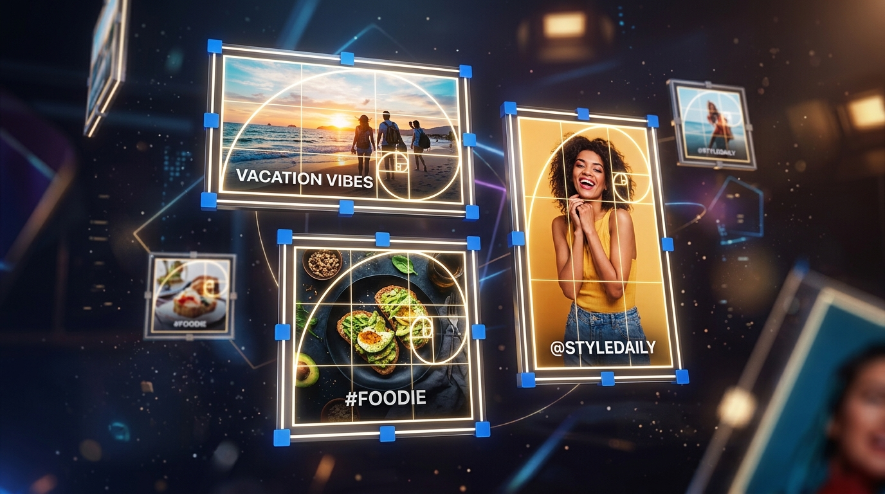

We've all been there: you take a beautiful landscape photo, attempt to set it as your Twitter header or Instagram profile picture, and the platform automatically crops out the most important part of the image.

Every social media platform has strict dimension requirements. If your image doesn't match their exact aspect ratio, their automated cropping algorithms will take over. 

In this guide, we'll cover the exact dimensions you need and how to quickly format your photos before uploading.

## The Golden Dimensions for 2026

Here are the ideal image dimensions for the top platforms:

* **Instagram Square Post:** 1080 x 1080 pixels (1:1 ratio)
* **Instagram Portrait Post:** 1080 x 1350 pixels (4:5 ratio)
* **Instagram/TikTok Stories:** 1080 x 1920 pixels (9:16 ratio)
* **Twitter (X) Post:** 1600 x 900 pixels (16:9 ratio)
* **LinkedIn Banner:** 1584 x 396 pixels (4:1 ratio)

## How to Resize and Crop Your Photos

Instead of using complex photo editing software like Photoshop, you can quickly achieve the perfect crop using our free browser tools.

### 1. Using the Image Cropper
If your photo has the right subject but too much background, use the [Image Cropper](/tools/image-cropper). You can select a predefined aspect ratio (like 1:1 or 16:9) and drag the box over your subject to ensure it fits perfectly.

### 2. Using the Image Resizer
If your photo is simply too large (e.g., a 4K image that is 10MB in size), use the [Image Resizer](/tools/image-resizer) to scale it down to exactly 1080px wide. This prevents social media platforms from applying their own aggressive, quality-destroying compression algorithms to your photo.

### 3. Creating the Perfect Profile Picture
Profile pictures are almost always displayed as circles now. Use our specialized [Profile Picture Maker](/tools/profile-picture-maker) to preview exactly how your photo will look when cropped into a circle. It guarantees your face will be perfectly centered without any guesswork!

These tools process selected images in your browser. Your image content is not uploaded to our server, which keeps personal photos under your control while you resize or convert them.
