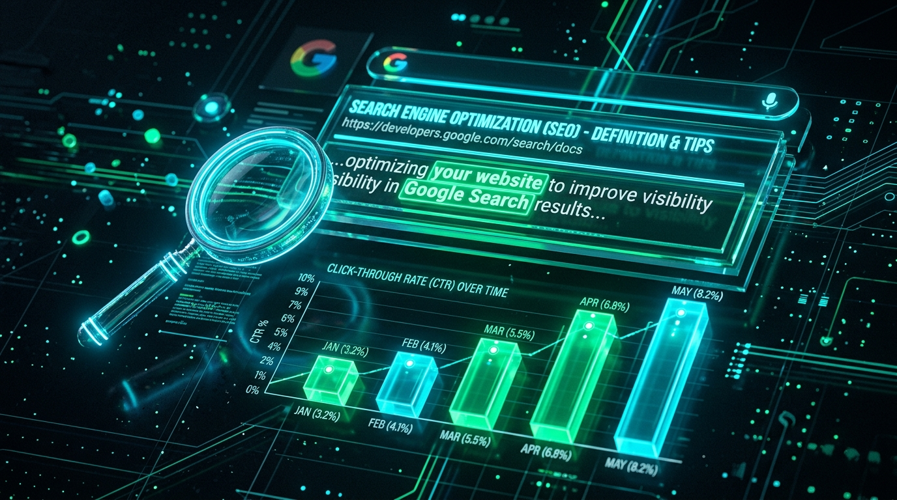

When you search for a term on Google, you are presented with a list of blue links. Beneath each blue link is a short paragraph of text. That paragraph is the **Meta Description**.

While Google explicitly states that meta descriptions are not a direct ranking factor in their algorithm, they are arguably the most important element for **Click-Through Rate (CTR)**. 

## The Power of Click-Through Rate

Imagine your website ranks #3 on Google for a highly competitive keyword. 
* The #1 result has a boring, generic meta description.
* Your #3 result has a compelling, action-oriented meta description that perfectly answers the user's intent.

Users are far more likely to click your link! When Google sees that your #3 link is getting more clicks than the #1 link, their algorithm will eventually promote your page to the top spot. That is why meta descriptions are an indirect, but highly potent, SEO ranking factor.

## How to Write the Perfect Meta Description

A perfect meta description should follow these three rules:
1. **Keep it under 155 characters:** If it's too long, Google will truncate it with an ellipsis (...), cutting off your pitch.
2. **Include your target keyword:** Google boldens the keyword in the search results, drawing the user's eye.
3. **Include a Call-to-Action:** Tell the user exactly what they will get if they click (e.g., "Read our guide", "Download the template", "Learn how to...").

## Checking Your Meta Description Length

It's difficult to count characters perfectly while writing. To ensure your meta descriptions never get truncated in the search results, use our [Meta Description Length Checker](/tools/meta-desc-checker). 

Simply paste your text, and it will instantly tell you if you are in the safe zone! We also offer a [Meta Title Length Checker](/tools/meta-title-checker) to make sure your headline fits perfectly as well.
