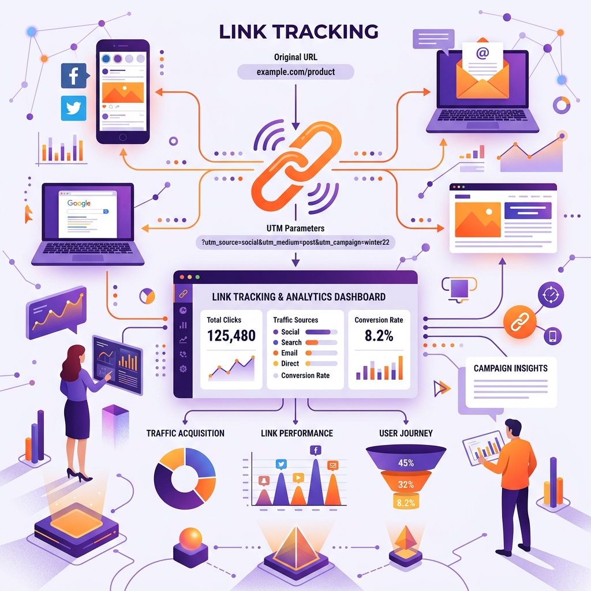

If you are running marketing campaigns across newsletter sponsorships, social media ads, affiliate partnerships, or influencer promotions, **knowing exactly where your website traffic comes from is critical to calculating ROI.**

Without proper campaign link tracking, Google Analytics 4 (GA4) bucket your valuable paid traffic into generic `(direct) / (none)` or `Unassigned` channels.

In this guide, we'll explain how UTM parameters work, standard naming conventions, and how to build clean, error-free campaign links in seconds.

---

## 1. What Are UTM Parameters?

UTM (Urchin Tracking Module) parameters are 5 standard snippet tags added to the end of a URL. When a user clicks a tagged link, Google Analytics reads these parameters to attribute the session.

Here are the 5 core parameters:

1. `utm_source`: Identifies the traffic source (e.g., `newsletter`, `google`, `facebook`).
2. `utm_medium`: Identifies the marketing medium (e.g., `cpc`, `email`, `social`, `banner`).
3. `utm_campaign`: Identifies the specific product launch or campaign name (e.g., `summer_sale_2026`).
4. `utm_term`: Used primarily for paid search keywords (e.g., `best_pdf_tools`).
5. `utm_content`: Used to differentiate links pointing to the same URL (e.g., `cta_button_top` vs `footer_link`).

---

## 2. Best Practices for Clean Campaign Links

To keep your analytics reports clean, adhere to these 3 strict rules:

### Rule 1: Always Use Lowercase
Analytics platforms are case-sensitive. `utm_source=Newsletter` and `utm_source=newsletter` will create **two separate reporting rows** in Google Analytics! Always use lowercase.

### Rule 2: Use Hyphens Instead of Spaces
Never put raw spaces in your URL parameters. Spaces get converted to unsightly `%20` encoding. Use hyphens (`-`) or underscores (`_`) consistently across all campaigns.

### Rule 3: Don't Use UTMs for Internal Links
Never put UTM parameters on internal links on your own site (e.g., linking from your homepage to a blog post). Doing so resets the user's active session and destroys your original acquisition channel data!

---

## 3. How to Build Campaign URLs Instantly

Manually typing out query strings like `?utm_source=facebook&utm_medium=cpc&utm_campaign=retargeting` leads to typos and broken links.

Using an automated tool prevents syntax errors:
1. Enter your landing page URL into our free [UTM Builder](/tools/utm-builder).
2. Fill in your Source, Medium, and Campaign names.
3. Copy the instantly formatted tracking link.

**Bonus Tip:** Long URLs packed with tracking parameters look clunky on social media or SMS campaigns. Once you generate your tracking link, pass it through our [Short Link Generator](/tools/short-link) or convert it into a scannable [QR Code Generator](/tools/qr-generator) for print marketing collateral!

---

## Conclusion

Accurate attribution is the foundation of data-driven marketing. By enforcing consistent UTM conventions and utilizing automated builders, you guarantee clean reporting in Google Analytics and make smarter marketing investments.

Build your next tracking link with our free, instant [UTM Builder](/tools/utm-builder)!
